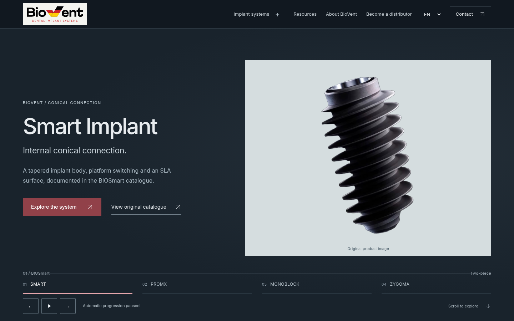
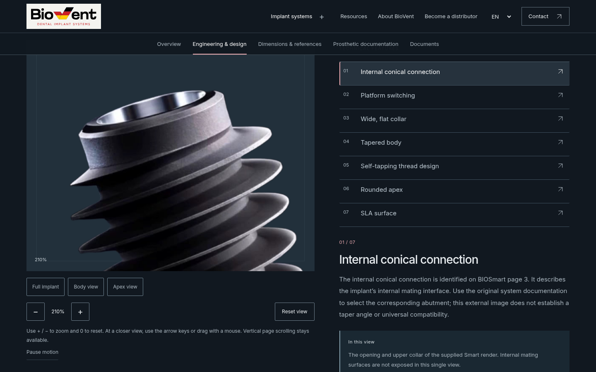

# BioVent V13 — indirilebilir teslim

Şirket unvanı: **Biovent Implant Systems GmbH** · Am Hagelkreuz 23, 41469 Neuss.

## Bilgisayarda siteyi açma

**[Windows ZIP dosyasını indir](https://raw.githubusercontent.com/vahitavcilar-sudo/biovent/delivery/v13-engineering-2026-10-21/biovent-v13-windows-test.zip)**

1. Bağlantıya normal sol tıklayın. ZIP dosya adıyla indirin; sağ tık “sayfayı farklı kaydet” kullanmayın.
2. İndirilenler klasöründe ZIP'e sağ tıklayın → **Tümünü ayıkla**.
3. `biovent-v13-test` klasörünü açıp **SITEYI-AC.bat** dosyasına çift tıklayın. Terminali açık tutun; tarayıcı Türkçe sayfayı açar. Node/Python kurulumu gerekmez.
4. İndirme bağlantısı ChatGPT tarayıcısında çalışmazsa bu GitHub sayfasındaki `biovent-v13-windows-test.zip` dosyasını açıp sağ üstteki **Download raw file** simgesini kullanın. Dosya bilgisayarınıza ancak indirince kaydolur.

## Diğer paketler

| Paket | Kullanım |
|---|---|
| [Kaynak ZIP](biovent-v13-source.zip) | Tam Next.js/React/TypeScript kaynakları, PHP alıcısı, testler ve raporlar |
| [Hosting ZIP](biovent-v13-hosting.zip) | Natro test belge köküne statik dosyalar; WordPress tema ZIP'i değildir |
| [Form backend ZIP](biovent-v13-form-backend.zip) | İsteğe bağlı özel PHP alıcı/worker ve iki kanonik JSON kayıt dosyası |
| [Görsel inceleme ZIP](biovent-v13-visual-review.zip) | Ayıklayın, içindeki index.html dosyasını açın: gerçek önce/sonra ekranları ve Lighthouse raporları |

[Kaynak GitHub dalı](https://github.com/vahitavcilar-sudo/biovent/tree/design/v13-engineering-2026-10-21) · [Tam kaynak commit'i](https://github.com/vahitavcilar-sudo/biovent/tree/f0e10feb862668bddf0516a194d413f0d527b043)

Smart ilk açılır. Beş saniyelik varsayılan ürün geçişi, V13 talebine göre odak/manuel incelemede durur; Oynat ile devam eder. Orijinal logo ve görseller, yedi Smart teknik bölgesi, belgeli protetik bileşenler, dört dil ve Arapça RTL korunur. 48 sayfa, 576 ekran ölçüsü, 96 tam sayfa erişilebilirlik taraması ve 41 PHP kontrolü geçti. LCP ana sayfada 3,048→2,426 s; Arapçada 3,182→2,562 s. Üç ölçülen sayfa 2,5 saniye hedefinin üzerindedir; alan verisi/INP bilinmiyor.

**Formlar hazır ZIP'te önizleme olarak çalışır; gerçek e-posta göndermez.** Alıcılar, gönderen, özel depolama ve hukuki ayarlar tamamlanmadan canlı gönderim açılmaz. PHP `mail()`/Natro ve gerçek posta kutusu teslimi test edilmedi. Fabrika/sertifika/üretim kökeni iddiaları eklenmedi. Canlı Natro/JetPress/WordPress değiştirilmedi. Windows x64 çapraz derlendi; ortak başlatıcı Linux'ta HTTP ile test edildi, fiziksel Windows bu ortamda çalıştırılmadı.

[V13_LOCAL_RUNNING.md](V13_LOCAL_RUNNING.md) · [V13_DEPLOYMENT.md](V13_DEPLOYMENT.md) · [V13_IMPLEMENTATION_REPORT.md](V13_IMPLEMENTATION_REPORT.md) · [V13_TECHNICAL_QA.md](V13_TECHNICAL_QA.md) · [V13_PRODUCTION_READINESS.md](V13_PRODUCTION_READINESS.md)

Her ZIP içinde SHA256-MANIFEST.json bulunur. Paket boyutları/hash'leri DELIVERY.json içinde kaydedilmiştir. Kaynak commit: f0e10feb862668bddf0516a194d413f0d527b043; son derleme: BBD6KvV55GQMfAz6Py4ea.
