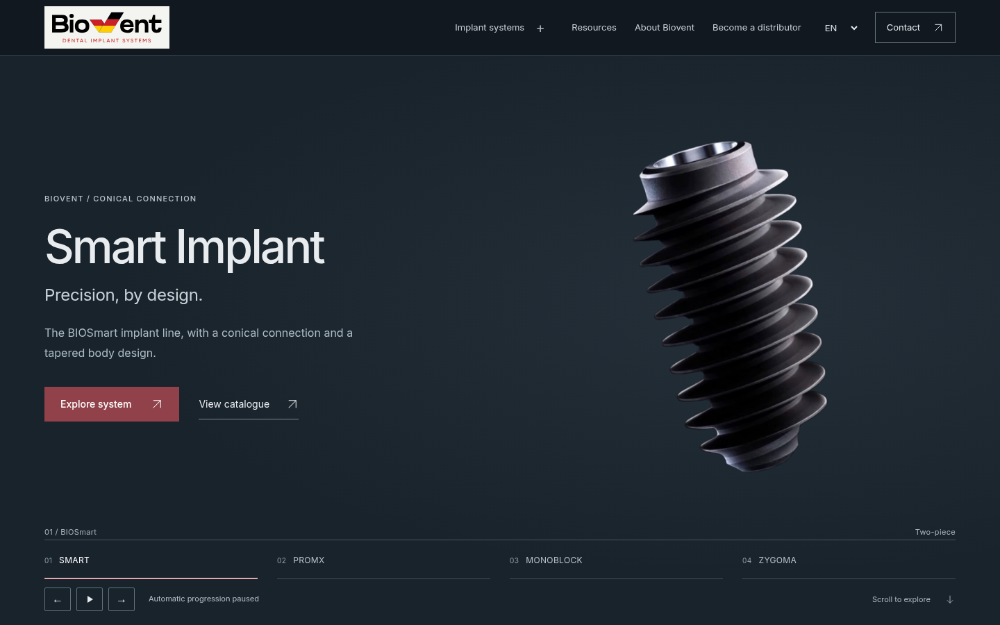

# BioVent V12 — indirilebilir dosyalar

Kaynak kod: https://github.com/vahitavcilar-sudo/biovent/tree/3b86e5728d8db2460393f6652d6020be53a52594
Build: `A6XzWk-OM9yukSmEjiWDu`

## Windows’ta siteyi açma

`biovent-v12-windows-test.zip` dosyasını açın, **Tümünü ayıkla** ile çıkarın ve `biovent-v12-test/SITEYI-AC.bat` dosyasını çalıştırın. Siyah pencere açık kalmalı. Node/Python gerekmez. Smart ilk üründür; slider beş saniyede değişir.

Formlar önizleme modundadır. Canlı Natro/WordPress değişmedi. Windows EXE çapraz derlendi; aynı kaynak Linux’ta HTTP/Chromium kontrollerinden geçti.

## Dosyalar

| ZIP | Boyut | İçerik |
|---|---|---|
| [biovent-v12-windows-test.zip](biovent-v12-windows-test.zip) | 43.1 MB | Windows’ta çalıştırılabilir site |
| [biovent-v12-source.zip](biovent-v12-source.zip) | 73.7 MB | Orijinal Next.js/React/TypeScript kaynak projesi |
| [biovent-v12-hosting.zip](biovent-v12-hosting.zip) | 40.1 MB | Natro / Apache / LiteSpeed için statik belge kökü |
| [biovent-v12-visual-review.zip](biovent-v12-visual-review.zip) | 28.8 MB | Önce/sonra ekranları, raporlar, offline index.html galerisi ve Lighthouse |

GitHub ZIP sayfası açılırsa **Download raw file** düğmesini kullanın. `Code > Download ZIP` bütün teslim dalını indirir; sadece Windows paketi yeterlidir. Her ZIP kendi SHA-256 manifestini içerir; `DELIVERY.json` arşiv boyut/hash değerlerini kaydeder.

## Sonuçlar ve sınırlar

48 sayfa / 576 ekran boyutu; 96 tam sayfa axe kontrolü ve 84 ölçü seçimi geçti. İlave form/inceleyici/karşılaştırma/slider kontrolleri rapordadır. Son Lighthouse erişilebilirlik 100, CLS <0.1; bazı sayfalarda 2.5 saniyelik LCP hedefi açık. INP, fiziksel Windows ve canlı Natro/PHP gönderimi doğrulanmadı. Kurumsal üretim/sertifika/iletişim kanıtları ve gerçek form alıcısı yayın öncesinde tamamlanmalı. Ayrıntılar `V12_QA_REPORT.md` ve `V12_DEPLOYMENT.md`.

Dört doğrudan ZIP bağlantısı HTTP 200 / application/zip ile yeniden indirildi; CRC ve tüm dosya SHA-256 değerleri doğrulandı. Ayrıntılar: [DOWNLOAD-VERIFIED.json](DOWNLOAD-VERIFIED.json).
